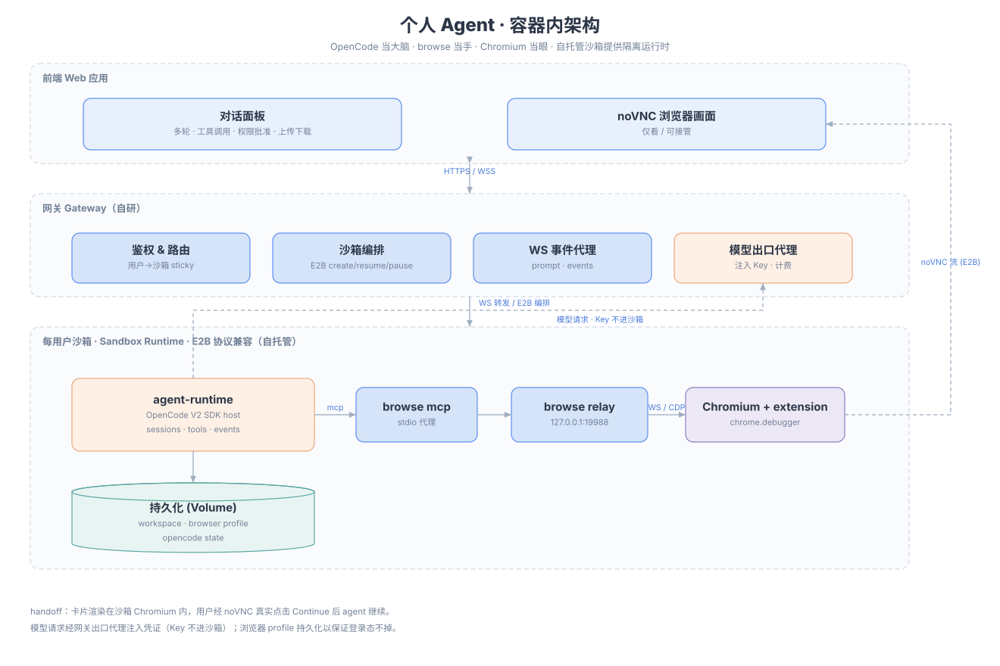
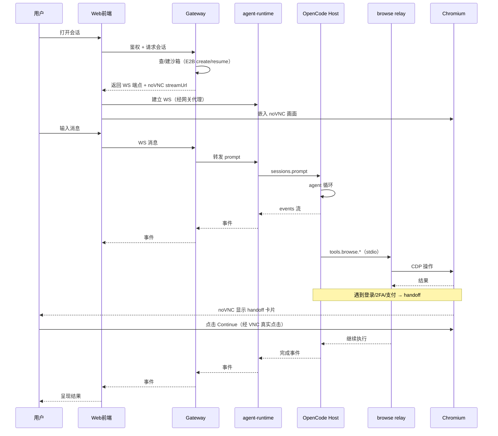

# 个人 Agent 架构设计

> 状态：Draft（讨论稿）
> 最后更新：2026-11-27
> 范围：**仅容器内模式（浏览器在每用户沙箱内）**。本机桥接模式（browse `--remote`）列为未来扩展，本期不实现。

---

## 1. 目标与非目标

### 目标
- 做成 muse 那样：**每个用户运行在一台独属于自己的虚拟机/容器里**，拥有持久的文件、登录态和浏览器。
- 用户在**自研 Web 应用**里使用：左侧对话，右侧实时看到并接管浏览器。
- 最大化复用，把自研代码压到最小：
  - **OpenCode V2 SDK** 负责 agent 循环、工具、权限、session、事件流、模型 provider、MCP。
  - **browse（OpenCode 团队的 MCP）** 负责全部浏览器控制（导航、点击、截图、录屏、网络抓包、handoff）。
  - **沙箱层可插拔（统一 E2B 协议）**：优先自托管 **agent-sandbox**（K8s，免持续付费），备选 E2B Cloud / Daytona；负责沙箱、桌面、有头 Chromium、noVNC 实时看屏、快照/暂停。

### 非目标（本期）
- 不实现"桥接用户本机真实浏览器"的模式（`browse --remote`），仅在设计上预留。
- 不自研浏览器自动化、不自研 noVNC 服务、不自研 agent loop。
- 不做 Windows 桌面（Linux 桌面即可）。

---

## 2. 设计原则

1. **沙箱即产品单位**：一个用户 = 一台沙箱；沙箱内是一个自洽的"云电脑"。
2. **agent 只认 relay**：无论浏览器在哪，agent 永远只连"一个 browse relay"，浏览器归属是底层细节。
3. **能复用绝不重写**：桌面/看屏用平台，agent 用 OpenCode SDK，浏览器用 browse。
4. **登录态是灵魂**：浏览器 profile 必须持久，睡醒不掉登录。
5. **凭证不进沙箱**：模型 Key 只在网关/出口，沙箱内拿不到明文。
6. **强隔离**：跑不可信网页要 VM 级或强沙箱隔离，不用裸容器。E2B Cloud 原生 Firecracker microVM；自托管 agent-sandbox 需配 **gVisor/Kata RuntimeClass** 达到等价隔离。

---

## 3. 总体架构



> 图由 `docs/diagrams/gen_arch.py` 生成；改布局后重跑 `python3 docs/diagrams/gen_arch.py` 即可更新 SVG。

**一句话**：控制面管"给每个用户一台机器"，沙箱里 OpenCode 当大脑、browse 当手、Chromium 当眼，Web 前端当脸。

---

## 4. 组件详解

### 4.1 沙箱（每用户运行时）

**核心设计：沙箱层可插拔，统一走 E2B 协议。**

agent-runtime 只依赖 **E2B SDK/协议**（`E2B_API_URL` / `E2B_DOMAIN` / `E2B_API_KEY`），底层沙箱提供方随时可换，业务代码不变：

| Provider | 形态 | 成本 | 隔离 | 备注 |
|---|---|---|---|---|
| **agent-sandbox（自托管，首选）** | K8s 上的 sandbox 运行时，E2B 协议兼容 | 只付自己的集群 | 容器级（可配 Kata/gVisor 升 VM 级） | Apache-2.0；自带 REST/MCP/Web UI、模板/预热池/暂停恢复/快照/scale-to-zero |
| E2B Cloud（备选） | 托管 | 按用量计费（$） | Firecracker microVM | 开箱即用、免运维 |
| Daytona（备选） | VM 沙箱 | 自托管/托管 | VM 级 | 需 Windows 或强 VM 隔离时考虑 |

**agent-sandbox 落地要点（自托管）**
- 前提：**Kubernetes 1.28+**。`kubectl apply -n agent-sandbox -f install.yaml` 部署，Ingress / port-forward 暴露 API。
- 协议兼容：设 `E2B_API_URL=https://<host>/e2b/v1`、`E2B_DOMAIN=<host>`、`E2B_API_KEY=<token>`，即可用 **E2B SDK** 创建/连接/暂停沙箱。
- 模板 = 容器镜像 + 元数据，**硬性要求镜像内跑 `envd`（端口 49983）**；`port` 决定启动探针端口。
- 桌面/VNC：镜像内起 Xvfb + Chromium + noVNC（如 6080），经 E2B per-port 路由访问：`https://6080-<sandboxID>.<domain>`；无泛域名时回退 `/sandboxes/router/<sandboxID>/6080`。
- 安全：**务必改掉默认 admin token**；多租户按 user/agent 隔离；不可信网页建议给沙箱配置 **gVisor/Kata RuntimeClass** + NetworkPolicy。

**沙箱内组成**（定制镜像预装，版本 pin）：

| 组件 | 作用 | 备注 |
|---|---|---|
| `envd`（49983） | E2B 协议 agent：commands/files/暂停快照都靠它 | **硬性要求**，从模板目录取版本固定的二进制 |
| `browse` CLI 二进制 | 提供 `browse mcp` 与 `browse serve`（relay） | 镜像内固定版本 |
| Chromium + browse extension | 被 agent 驱动的"眼和手" | 预装扩展并预配对 |
| Xvfb + noVNC（6080） | 用户看屏与接管 | 有头 Chromium 跑在虚拟显示上 |
| `agent-runtime` | 常驻 Node/Bun 进程，持有 OpenCode SDK host，开 WS 端口给网关 | 自研，见 4.2 |
| OpenCode 配置 | `mcp.servers.browse`、provider、permissions | 由镜像模板 + plugin 生成 |

**关键环境变量**（镜像层）：`OPENCODE_BROWSER_AUTO_UPDATE=off`（禁止每沙箱随机自更新）、固定 `XDG_DATA_HOME`/配置目录到持久路径。

**本实例落地（已实测）**
- 节点 aarch64；官方镜像 **amd64-only** 且 binfmt 不一致 → 构建**原生 arm64** 镜像，避免 `exec format error`。
- envd 用 E2B 发布产物 `envd/v0.10.2/arm64/envd`，启动 `-isnotfc -no-cgroups -port 49983`（普通容器必需）。
- 镜像由 GitHub Actions `ubuntu-24.04-arm` 构建，`provenance/sbom=false` 产出**单 manifest**（OCI index 会在部分节点 `no matching manifest`）。
- 端口路由用 **path 形式**：`https://<host>/sandboxes/router/<sandboxID>/<port>/`（HTTP 200 + WS 101）；子域名形式不可用。
- 模板 `desktop`：`image=ghcr.io/proximity333/agent-desktop:arm64`，`port=6080`。

### 4.2 agent-runtime（沙箱内自研薄层）

职责：把 OpenCode SDK 包成一个可由网关访问的常驻服务。

- `OpenCode.create({ location: { directory: "/workspace" }, plugins: [...] })` 持有 host。
- 订阅 `opencode.events.subscribe()`，通过自身 WS/HTTP 端口流给网关。
- 接收网关转发的"用户 prompt / 权限批准 / 中断"等指令，调用 `sessions.*`。
- 通过 **plugin** 做多租户定制：注入用户级 system prompt、工具/权限策略、品牌信息。
- 模型请求指向网关出口（不持有 Key 明文）。

> 设计要点：选择"SDK 进程内嵌入 + 自开 WS"而非"跑官方 server + client"，是为了**掌控进程生命周期与鉴权**，并让网关只需做一层代理。

### 4.3 browse（浏览器控制）

标准化三件套，沙箱内自洽：

- `browse mcp`：agent 通过 MCP stdio 启动它，转发到 relay。
- `browse relay`：`127.0.0.1:19988`，保存 tab/handoff/录制/网络抓包，讲 CDP。
- `browse extension`：WS 连 relay，用 `chrome.debugger` 驱动 Chromium。

在 OpenCode 中默认走 **Code Mode**，agent 以 `tools.browse.*` 调用。**handoff**（登录/2FA/支付）的卡片渲染在沙箱 Chromium 里，用户经 noVNC 画面点击闭环，无需自研 handoff 协议。

### 4.4 网关（自研，唯一"重"的部分）

- **鉴权 + 路由**：用户 → 其沙箱（sticky）。
- **生命周期**：调用 E2B SDK 做 create / resume / pause / snapshot；给前端下发 WS 端点与 noVNC `streamUrl`。
- **事件代理**：前端 WS ↔ 沙箱内 agent-runtime WS，做 token 校验后转发。
- **模型出口代理**：OpenCode 的 provider baseURL 指向这里，网关侧注入 Key（含计费/限额统计），**Key 不进沙箱**。

### 4.5 前端（自研 Web 应用）

- **左：对话面板**——多轮消息、工具调用渲染、opencode 的权限请求弹窗、文件上传下载。
- **右：浏览器画面**——直接 `iframe` 嵌沙箱模板的 noVNC 地址（如 6080 端口路由）；"仅看 / 可操作"按需切换。
- **handoff**：卡片本就在 noVNC 画面里；UI 侧可选做高亮/提示同步。

---

## 5. 关键流程

### 5.1 一次完整对话时序



### 5.2 沙箱生命周期

| 状态 | 触发 | 动作 | 计费 |
|---|---|---|---|
| 无 | 用户首次登录 | 从预热 snapshot 创建沙箱 | 启动 |
| 运行 | 使用中 | 全速运行 | 按秒（CPU/内存） |
| 暂停 | 空闲 N 分钟 | `pause`（保留内存/文件系统） | 大幅降低/近似仅存储 |
| 恢复 | 用户回来 | `resume`，秒级恢复 | 恢复运行 |
| 归档 | 长期不活跃（如 7 天） | `snapshot` 到对象存储 + 销毁 | 仅存储 |
| 重建 | 归档后回来 | 从 snapshot 重建 | 启动 |

> 成本核心：每用户常驻一个 Chromium 内存不低，**pause 策略决定单位经济性**。

---

## 6. 持久化

三块必须持久，否则"睡醒掉登录"：

| 数据 | 落点 | 说明 |
|---|---|---|
| 用户工作文件 | `/workspace`（沙箱文件系统） | pause/snapshot 保留 |
| **浏览器 profile（登录态/cookies）** | 固定路径（如 `/home/user/.config/chromium`） | 个人 agent 的灵魂 |
| OpenCode 状态（session 等） | `XDG_DATA_HOME` → 持久目录 | 不要用临时盘 |

沙箱 pause/snapshot 覆盖文件系统即可满足；长期归档时把上述目录打入 snapshot/对象存储。

---

## 7. 安全

- **模型 Key 不进沙箱**：网关出口代理注入；browse relay 已是 allowlist 环境，避免泄漏。
- **隔离级别取决于 provider**：E2B Cloud 是 Firecracker microVM；自托管 agent-sandbox 默认是**容器级**，跑不可信网页时务必给沙箱配 **gVisor/Kata RuntimeClass**（升到 VM 级）并加 NetworkPolicy，别用普通容器裸跑。
- **browse 自带防线**：relay token、extension 白名单、`execute` 的 QuickJS 沙箱、CDP guardrails（禁清 cookie/关浏览器等）。
- **版本 pin**：镜像固定 browse 版本并关闭自动更新，避免版本漂移。
- **网络出口策略**：沙箱出站经网关/代理，白名单必要域名，防止数据外泄与滥用。
- **鉴权**：前端到网关、网关到沙箱 WS 均需 token；noVNC 用沙箱模板的鉴权地址。

---

## 8. 技术选型汇总

| 关注点 | 选型 | 理由 |
|---|---|---|
| Agent 内核 | **OpenCode V2 SDK**（`@opencode/sdk`，进程内嵌入） | 省掉 agent loop/工具/权限/session/事件 |
| 不使用 | `@opencode/sdk/workerd`（Cloudflare DO） | 无 fs/进程/浏览器，跑不了 browse |
| 浏览器控制 | **browse MCP** | 导航/点击/截图/录屏/网络/handoff 全覆盖 |
| 运行时沙箱 | **agent-sandbox（自托管，首选）** / E2B Cloud（备选） | E2B 协议兼容、可插拔；自托管免持续付费 |
| 沙箱协议 | E2B SDK/协议（`E2B_API_URL`/`E2B_DOMAIN`/`E2B_API_KEY`） | 一套代码切换 provider |
| 事件传输 | WebSocket（网关代理） | 低延迟、双向 |
| 看屏 | 沙箱模板内的 noVNC（如 6080） | 零自研 |
| 前端 | React/Next 自研 Web 应用 | 聊天 + iframe noVNC |
| 控制面 | 轻量自研（Node）+ E2B SDK（指向所选 provider） | 编排/鉴权/计费 |

---

## 9. 建议的仓库结构（monorepo）

```
personal-agent/
├─ docs/
│  └─ ARCHITECTURE.md
├─ apps/
│  ├─ web/            # 前端：对话 + noVNC iframe
│  └─ gateway/        # 网关：鉴权/路由/编排/事件代理/模型出口
├─ packages/
│  ├─ sandbox-image/  # 沙箱模板镜像：envd + Chromium + browse + agent-runtime + 配置
│  ├─ agent-runtime/  # 沙箱内进程：OpenCode SDK host + WS 服务 + 插件
│  └─ shared/         # 协议/类型/常量
└─ package.json
```

---

## 10. 风险与 POC 验证清单（Phase 0）

> 可执行的详细清单（步骤 / 通过标准 / 失败退路 / Go-NoGo）见 [`docs/PHASE0-POC.md`](./PHASE0-POC.md)。

三个高风险点必须在正式开发前打穿：

| 风险点 | 验证方法 | 通过标准 |
|---|---|---|
| `chrome.debugger` 在自托管沙箱的稳定性 | 沙箱（agent-sandbox + 桌面镜像）内装 browse+扩展，跑一段真实网页操作 | 连续多步操作无断连/无非预期错误 |
| noVNC 用户操作与 CDP 并发 | 同一 Chromium：agent 操作时用户在 noVNC 点击 | handoff 卡片能点、agent 能继续、二者不打架 |
| 浏览器 profile 持久化 | 登录一次 → pause → resume | 登录态仍在，无需重登 |
| OpenCode SDK 在沙箱内跑通 | agent-runtime 启动 + 一轮对话 + browse 工具调用 | 事件流正常、`tools.browse.*` 可调 |
| 版本/自动更新 | 镜像内固定版本 + 关自动更新 | 重启不下载新版本 |

---

## 11. 路线图

- **Phase 0（验证，约 1 周）**：逐项打穿第 10 节风险；三者（OpenCode SDK / browse / 自托管沙箱桌面）分别跑通再合并。
- **Phase 1（MVP，单租户）**：Web（对话+noVNC）+ 容器内模式 + OpenCode SDK + browse + 沙箱生命周期（E2B 协议，agent-sandbox）。
- **Phase 2（多租户）**：鉴权/计费/路由、pause 冷启动、snapshot 归档回收、模型出口代理。
- **Phase 3（增强）**：录屏/网络抓包对外化、fork 分支实验、更多平台适配。

---

## 12. 未来扩展：本机桥接模式（本期不做）

设计上预留，利用 browse 自带能力，几乎零额外逻辑：

- 沙箱内 relay 以 `browse --remote` 暴露到网络；用户本机 Chrome + extension 经 Tailscale/WireGuard 连过来。
- 对 agent 完全透明：仍是"一个 relay"，只是背后的 extension 来自用户本机。
- 价值：用用户本机真实登录态与扩展；代价：网络打洞/组网、每沙箱可达地址、需装扩展。
- 抽象接口：`BrowserBackend` 两实现——`EmbeddedDesktop`（本期）/ `RemoteBridge`（未来）。

---

## 附录：关键事实速记

- **browse**：`browse mcp`（stdio 代理）→ relay（`browse serve`，`127.0.0.1:19988`）→ extension（WS + `chrome.debugger`）。有 handoff、录屏、网络抓包。默认每小时自更新（需关闭）。仅 Chromium 系；会有"正在调试"条。
- **OpenCode V2 SDK**：`OpenCode.create()` 进程内 host，无 HTTP listener；`events.subscribe()` 拿事件流；`sessions.create/prompt`；plugin 可 `agent.transform` 定制。
- **agent-sandbox（自托管首选）**：K8s 1.28+，`kubectl apply -n agent-sandbox -f install.yaml`；E2B 协议兼容（`E2B_API_URL`/`E2B_DOMAIN`/`E2B_API_KEY`）；镜像需 `envd` on 49983；支持 code/browser/desktop(VNC)/shell、模板/预热池/暂停恢复/快照/scale-to-zero；自带 REST/MCP/Web UI；**默认 admin token 必须改**。
- **E2B Cloud**（备选）：托管，Firecracker microVM，noVNC `streamUrl()`，按量计费。
- **Daytona**（备选）：VM 沙箱，x11vnc+noVNC，snapshot，Linux/Windows。
